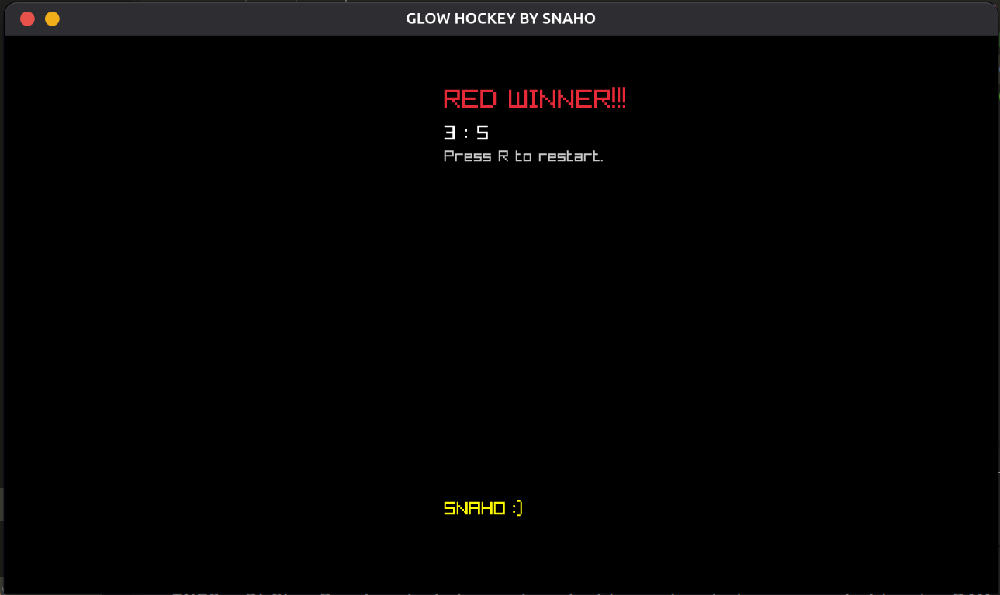

# 🏓 Pong

A fast-paced, 2-player local arcade Pong game built from scratch in C using the **Raylib** game engine framework. Control your paddles, deflect the ball with dynamic spin physics, score points, and be the first to reach 5 points to claim victory!

> ⚠️ **Important Note:** This game is strictly designed for **Local 2-Player** gameplay (Player 1 vs Player 2). Single-player mode against an AI opponent is currently **not supported**.

---

## 📸 Screenshots

| Gameplay | Result |
| :---: | :---: |
|  |  |

---

## ✨ Features

- **2-Player Local Only:** Face off on the same keyboard with independent controls for Player 1 (Green) and Player 2 (Red).
- **Dynamic Angle Physics:** Ball speed and vertical trajectory change dynamically based on where it impacts the paddle.
- **Score System & Win Condition:** Live score tracking with dynamic winner detection when a player reaches 5 points.
- **Display Options:** One-key fullscreen toggle (`Z`) and instant match restart (`R`).

---

## 🎮 Controls

| Action | Primary Key | Target / Scope |
| :--- | :--- | :--- |
| Move Paddle Up / Down | `Q` / `A` | Player 1 (Green) |
| Move Paddle Up / Down | `K` / `M` | Player 2 (Red) |
| Toggle Fullscreen | `Z` | Global Window |
| Restart Match | `R` | *(Available on Game Over screen)* |

> 💡 **Customizing Controls:** To change or rebind the movement keys, inspect lines 37 to 41 in `pong.c`.

---

## ⚙️ Prerequisites & Raylib Installation

Before compiling and running the game, ensure you have a C compiler (`gcc` or `clang`) and the **Raylib** library installed on your system.

####  1. Linux Setup

##### Ubuntu / Debian / Mint
```bash
sudo apt update
sudo apt install build-essential libraylib-dev -y
```

##### Fedora
```bash
sudo dnf install gcc raylib-devel -y
```

##### Arch Linux / Manjaro
```bash
sudo pacman -S gcc raylib --noconfirm
```

---

####  2. macOS Setup

Make sure you have [Homebrew](https://brew.sh/) installed, then run:

```bash
# Install Command Line Tools (if not installed)
xcode-select --install

# Install Raylib via Homebrew
brew install raylib
```

---

####  3. Windows Setup

##### Method A: Using MSYS2 / MinGW-w64 (Recommended)
1. Install [MSYS2](https://www.msys2.org/).
2. Open the **MSYS2 UCRT64** terminal and install `gcc` and `raylib`:
   ```bash
   pacman -S mingw-w64-ucrt-x86_64-gcc mingw-w64-ucrt-x86_64-raylib
   ```
3. Add `C:\msys64\ucrt64\bin` to your System Environment Variables (PATH).

##### Method B: Standalone w64devkit
1. Download the lightweight [w64devkit + Raylib bundle](https://www.raylib.com/).
2. Extract the folder and use `w64devkit.exe` to compile directly.

---

## 🚀 How to Clone, Build, and Run

### 1. Clone the Repository

Clone the project from the `Pong` branch:

```bash
git clone -b Pong [https://github.com/snaaaho/Game.git](https://github.com/snaaaho/Game.git)
cd Game
```

---

### 2. Compile and Run

####  Linux
```bash
gcc pong.c -o game -lraylib -lGL -lm -lpthread -ldl -lrt -lX11
./game
```

####  Windows (MinGW / Command Prompt)
```cmd
gcc pong.c -o game.exe -lraylib -lopengl32 -lgdi32 -lwinmm
game.exe
```

####  macOS
```bash
clang pong.c -o game -lraylib -framework OpenGL -framework Cocoa -framework IOKit -framework CoreVideo
./game
```