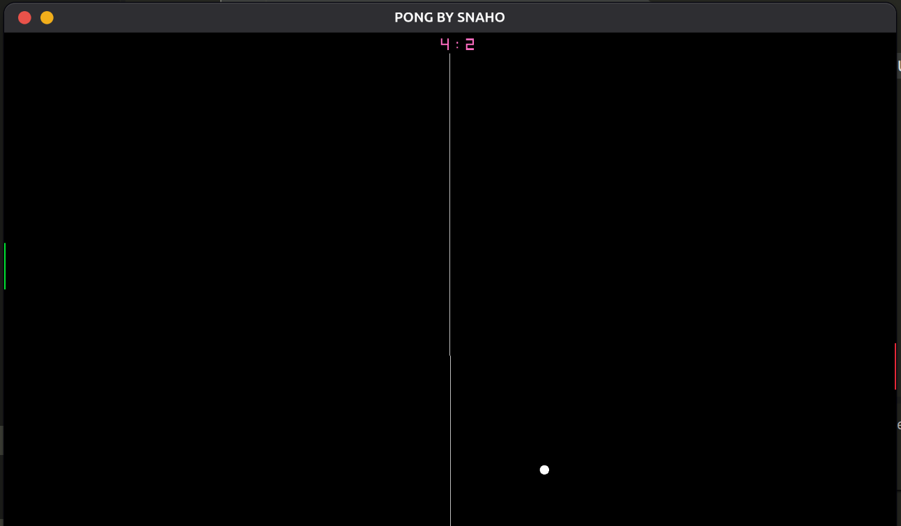
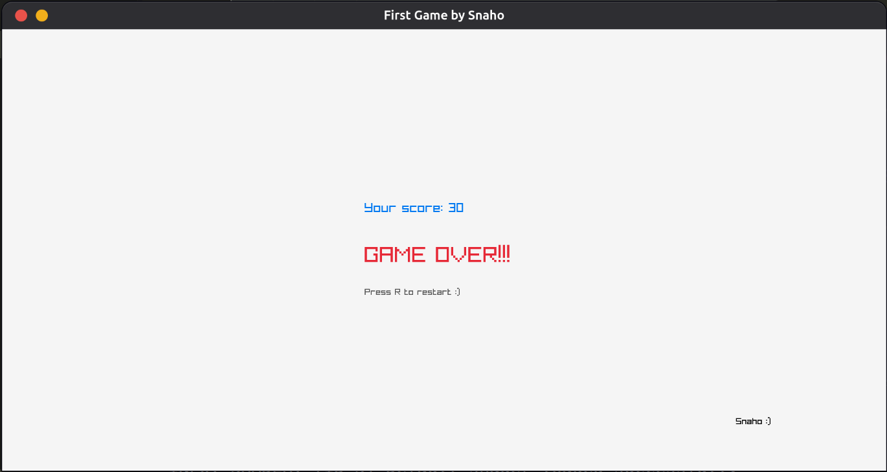

# 🪙 2D Coin Collector

A fast-paced, lightweight 2D arcade game built from scratch in C using the **Raylib** game engine framework. Navigate your player, dodge moving hazard obstacles, collect coins to boost your score, and try to survive before time runs out!

---

## 📸 Screenshots

| Gameplay | Game Over |
| :---: | :---: |
|  |  |

---

## ✨ Features

- **Fluid Movement:** Smooth circle player movement with screen boundary collision handling.
- **Dynamic Hazards:** Bouncing enemy obstacles that challenge your reaction time.
- **Score & Timer System:** Real-time score counting and 60-second survival countdown.
- **Game State Management:** Interactive state machine for gameplay, timer expiration, and restart screens.

---

## 🎮 Controls

| Action | Primary Key | Alternative Key |
| :--- | :--- | :--- |
| Move Up | `W` | `Up Arrow` |
| Move Down | `S` | `Down Arrow` |
| Move Left | `A` | `Left Arrow` |
| Move Right | `D` | `Right Arrow` |
| Restart Game | `R` | *(Available on Game Over screen)* |

---

## ⚙️ Prerequisites & Raylib Installation

Before compiling and running the game, ensure you have a C compiler (`gcc` or `clang`) and the **Raylib** library installed on your system.

####  1. Linux Setup
### 🐧
#### Ubuntu / Debian / Mint
```bash
sudo apt update
sudo apt install build-essential libraylib-dev -y
```

#### Fedora
```bash
sudo dnf install gcc raylib-devel -y
```

#### Arch Linux / Manjaro
```bash
sudo pacman -S gcc raylib --noconfirm
```

---

####  2. macOS Setup

Make sure you have [Homebrew](https://brew.sh/) installed, then run:

```bash
# Install Command Line Tools (if not installed)
xcode-select --install

# Install Raylib via Homebrew
brew install raylib
```

---

####  3. Windows Setup

#### Method A: Using MSYS2 / MinGW-w64 (Recommended)
1. Install [MSYS2](https://www.msys2.org/).
2. Open the **MSYS2 UCRT64** terminal and install `gcc` and `raylib`:
   ```bash
   pacman -S mingw-w64-ucrt-x86_64-gcc mingw-w64-ucrt-x86_64-raylib
   ```
3. Add `C:\msys64\ucrt64\bin` to your System Environment Variables (PATH).

#### Method B: Standalone w64devkit
1. Download the lightweight [w64devkit + Raylib bundle](https://www.raylib.com/).
2. Extract the folder and use `w64devkit.exe` to compile directly.

---

## 🚀 How to Clone, Build, and Run

### 1. Clone the Repository

Clone the project from the `2d-coin-collector` branch:

```bash
git clone -b 2d-coin-collector https://github.com/snaaaho/Game.git
cd Game
```

---

### 2. Compile and Run

> **Note:** If your C source file is named something other than `game1.c` (e.g., `main.c`), replace `game1.c` in the commands below with your actual filename.

####  Linux
```bash
gcc game1.c -o game -lraylib -lGL -lm -lpthread -ldl -lrt -lX11
./game
```

####  Windows (MinGW / Command Prompt)
```cmd
gcc game1.c -o game.exe -lraylib -lopengl32 -lgdi32 -lwinmm
game.exe
```

####  macOS
```bash
clang game1.c -o game -lraylib -framework OpenGL -framework Cocoa -framework IOKit -framework CoreVideo
./game
```

---